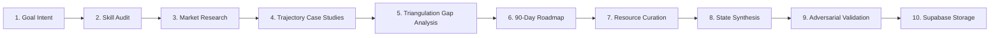

# Placey MACOS 🚀

> **A genuine, dynamic multi-agent career & skill intelligence platform.**  
> Built to eliminate generic chatbot advice and actually research the shortest, evidence-backed path to any career goal.

---

## 💡 Why I Built This

Most AI career advice tools are fundamentally broken. Ask them how to transition careers, and they either:
1. Spout generic platitudes (*"learn Python, read papers, do projects"*), or
2. Force celebrity role models onto completely unrelated jobs (like telling someone who wants to be a restaurant server to *"learn from Satya Nadella or DJ Patil"*).

I built **MACOS** (*Multi-Agent Career & Occupational Synthesis*) around a simple, realistic question:

```text
WHERE YOU ARE (Actual Resume Evidence)
       ↓
WHERE YOU WANT TO GO (Target Occupation)
       ↓
HOW REAL PRACTITIONERS GOT THERE (Real Case Studies)
       ↓
SHORTEST PRACTICAL ROADMAP FOR YOU (90-Day Action Plan)
```

No hardcoded personas, no fake local agents, and no tech-bias leakage when you're targeting non-tech fields.

---

## 🧠 How It Works (The 10-Agent Pipeline)

Instead of dumping everything into one prompt, MACOS breaks the problem down into a pipeline of specialized agents running on **Azure AI Foundry (GPT-4o)**:



1. **Goal & Intent Agent:** Classifies the domain objectively (hospitality, trades, healthcare, tech, arts) so non-tech goals don't get contaminated with software advice.
2. **Forensic Skill Discovery Agent:** Scans your résumé for *actual proof-of-work* and demonstrable evidence, separating proven capabilities from unverified buzzwords.
3. **Market Intelligence Agent:** Synthesizes live market hiring expectations, core tools, and daily responsibilities for the target role.
4. **People & Trajectory Agent:** Analyzes real-world practitioner trajectories as *case studies* (not celebrity role models) to see what steps are transferable to you.
5. **Triple-Triangulation Gap Agent:** Compares your background against market requirements and trajectory precedents to calculate a calibrated **0–100 Readiness Score**.
6. **Fast-Path Roadmap Architect:** Generates an actionable 90-day plan split into four execution phases: `LEARN` → `BUILD` → `DEMONSTRATE` → `REASSESS`.
7. **Resource Curation Agent:** Recommends verified books, guides, tools, and certifications specific to your target domain.
8. **Synthesis Agent:** Combines all agent outputs into a unified, coherent state.
9. **Adversarial Validation Agent:** Acts as an internal critic. It audits the generated roadmap for domain sanity, hallucination checks, and feasibility before anything gets saved.
10. **Persistence Layer:** Stores structured analysis records in Supabase for fast frontend visualization.

---

## 🛠️ Tech Stack

- **Frontend & App:** Next.js 16 (App Router, Turbopack), React, Tailwind CSS
- **AI Core:** Microsoft Azure AI Foundry (`gpt-4o` reasoning tier) via custom `ModelRouter`
- **Type Safety & Schemas:** TypeScript + Zod (using schema unions and transformers to handle irregular LLM outputs)
- **Database:** Supabase (PostgreSQL)

---

## ⚡ Quickstart

### 1. Clone & Install
```bash
git clone https://github.com/yashmakkar5/Placey-macos2.git
cd Placey-macos2
npm install
```

### 2. Configure Environment
Create a `.env.local` file in the root:
```env
AZURE_OPENAI_ENDPOINT="https://<your-resource>.openai.azure.com/"
AZURE_OPENAI_API_KEY="<your-azure-key>"
AZURE_OPENAI_DEPLOYMENT_NAME="gpt-4o"
NEXT_PUBLIC_SUPABASE_URL="https://<your-project>.supabase.co"
NEXT_PUBLIC_SUPABASE_ANON_KEY="<your-supabase-key>"
```

### 3. Run Dev Server
```bash
npm run dev
```
Open [http://localhost:3000](http://localhost:3000) to start testing.

### 4. Run Pipeline Verification
To run an automated test across the agent pipeline:
```bash
npx ts-node scripts/verify-full-pipeline.ts
```

---

## 🔍 Key Engineering Challenges Solved

- **Handling LLM Format Inconsistencies:** Real-world model outputs often alternate between strings and arrays. We built custom Zod union transformers across all agent outputs to coerce irregular JSON payloads without crashing the pipeline.
- **Domain Guardrails:** Added strict domain isolation directives to prevent the model from recommending coding or tech frameworks for hospitality, crafts, or healthcare roles.
- **Adversarial Quality Control:** Added an automated critique step (`validationAgent`) to ensure recommendations are grounded and verifiable before presenting them to the user.

---

## 👤 Author

Developed by **Yash Makkar** ([@yashmakkar5](https://github.com/yashmakkar5))
